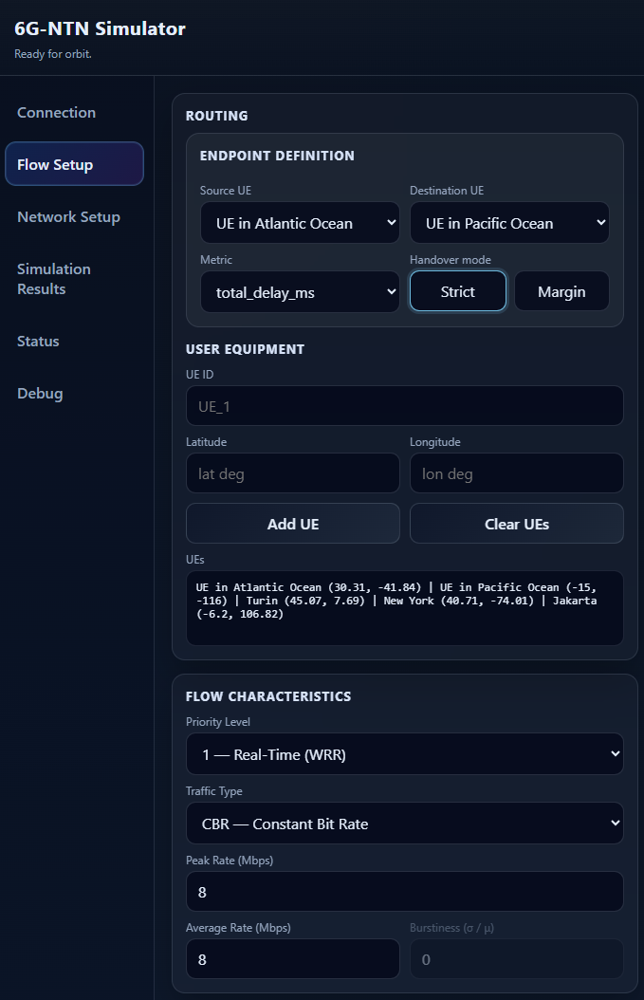
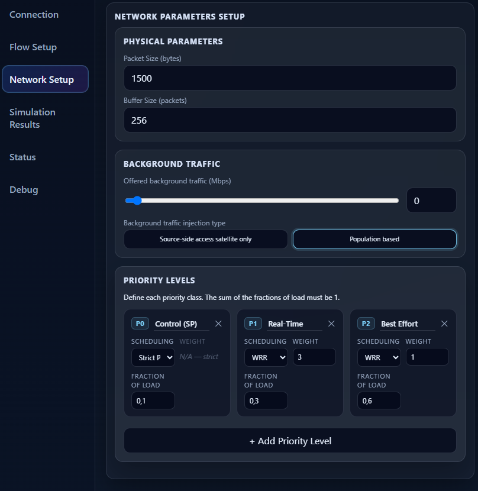
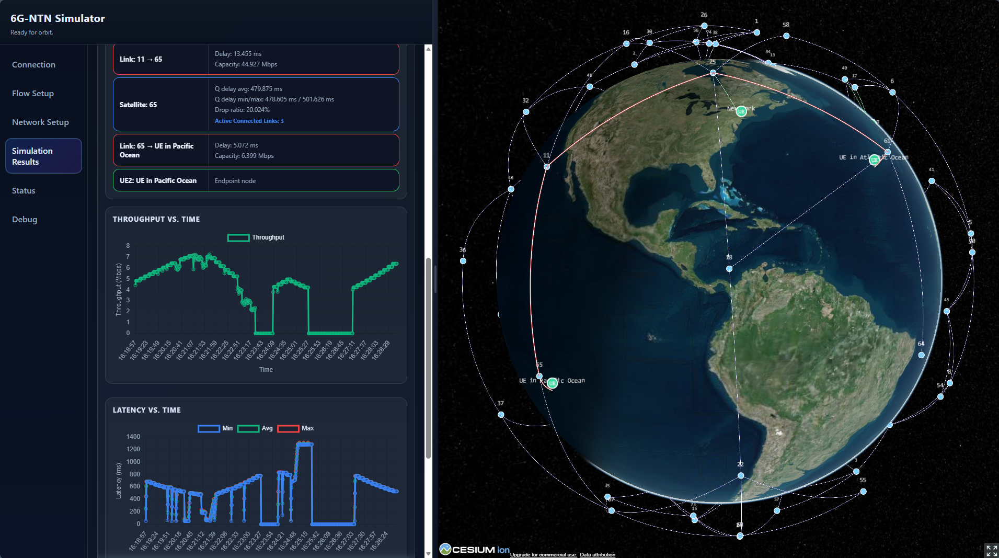

# 6G LEO Satellite NTN Simulator

A simulation framework for 6G non-terrestrial networks (NTN), focused on low-Earth-orbit (LEO) satellite communications. The project models dynamic direct-to-device connectivity over moving satellite constellations, evaluates routing and handover decisions under time-varying conditions, and exposes the results through an interactive 3D visualization interface.

The simulator combines three complementary layers:

- MATLAB handles the physical and orbital layer, including TLE-based propagation, Earth-occlusion checks, link-budget estimation, and satellite positioning.
- Python implements the network layer, orchestration, routing logic, handover policies, and packet-level simulation.
- A browser-based frontend renders the network and KPI results on a CesiumJS globe for live inspection.

## Project overview

<table>
  <tr>
    <td align="center">
      
      <br />
      <em>Flow Setup tab</em>
    </td>
    <td align="center">
      
      <br />
      <em>Network Setup tab</em>
    </td>
  </tr>
  <tr>
    <td colspan="2" align="center">
      
      <br />
      <em>Simulation Results tab</em>
    </td>
  </tr>
</table>


The core idea is to make the behavior of a LEO NTN visible and measurable. Satellites move continuously, propagation delay changes with geometry, link conditions vary with visibility and SNR, and routes need to be recomputed as the topology evolves. This project provides an end-to-end framework for exploring those dynamics in a controlled simulation environment.

It is intended for research, experimentation, and demonstration of:

- satellite visibility and connectivity windows,
- routing over a time-varying graph,
- handover and route adaptation under changing link quality,
- packet-level performance metrics such as throughput, latency, and loss,
- operational visualization of satellite paths and ground connectivity.

## Features

- TLE-driven constellation simulation with orbital propagation and Earth-fixed positioning.
- MATLAB/Python integration for realistic physical-layer and network-layer modeling.
- Graph-based routing using metrics such as minimum hop count, delay, and distance.
- SNR-triggered handover and adaptive route updates.
- Packet-level traffic simulation with queueing and network performance metrics.
- REST API interfaces for simulation initialization, polling, and status checks.
- Interactive 3D visualization through CesiumJS, with route rendering and KPI plots.

## Documentation

- [InstallationGuide.md](./InstallationGuide.md) — setup instructions for MATLAB/Python environment configuration.
- [python/README.md](./python/README.md) — backend and frontend execution workflow.
- [docs/DOCUMENTATION.md](./docs/DOCUMENTATION.md) — detailed architecture, API reference, and technical design notes.

## Repository structure

```text
.
|-- docs/
|   |-- images/
|   |-- Customer & User Guide.pdf
|   |-- DOCUMENTATION.md
|   `-- PowerPoint Presentation.pdf
|-- matlab/
|   |-- IridiumNEXT.tle
|   |-- OneWeb.tle
|   |-- SatellitesOrbitalParameters.tle
|   |-- starlink.tle
|   `-- Functions/
|       |-- addGroundStations.m
|       |-- addSatellites.m
|       |-- channelDelay.m
|       |-- channelModel.m
|       |-- gsSatDistances.m
|       |-- ntn_bridge_state.m
|       |-- ntn_initialize_simulation.m
|       |-- ntn_link_budget.m
|       |-- ntn_link_capacity.m
|       |-- ntn_positions_matrix.m
|       |-- ntn_satellite_positions.m
|       |-- ntn_update_positions.m
|       `-- satDistances.m
|-- python/
|   |-- api_server.py
|   |-- README.md
|   |-- algorithms/
|   |   |-- dijkstra_router.py
|   |   |-- min_hop_count.py
|   |   `-- disco_route.py
|   |-- services/
|   |   |-- __init__.py
|   |   |-- orchestrator.py
|   |   `-- topology.py
|   |-- packetSimulator/
|   |   |-- monitoring.py
|   |   |-- network_models.py
|   |   |-- network_orchestrator.py
|   |   |-- queueing.py
|   |   `-- traffic_generation.py
|   `-- utils/
|       `-- matlab_bridge.py
|-- visualizer/
|   |-- index.html
|   `-- landing_site.html
|-- .gitignore
|-- InstallationGuide.md
|-- LICENSE
|-- README.md
`-- requirements.txt
```

## Getting started

For a complete setup and launch procedure, begin with [InstallationGuide.md](./InstallationGuide.md). Once the environment is ready, follow the instructions in [python/README.md](./python/README.md) to start the backend and open the web interface.

## Authors

This project was developed by:

- Giulio Bollea — Network Layer Simulation & Integration Testing
- Paolo Cerutto — Physical Layer Simulation & Integration Testing
- Gianluca Ditella — Frontend Integration, Visualization Flow & Repository Coordination
- Jacopo Piergiovanni — Architecture & Routing Logic Implementation

## License

This project is distributed under the terms of the license described in [LICENSE](./LICENSE).
