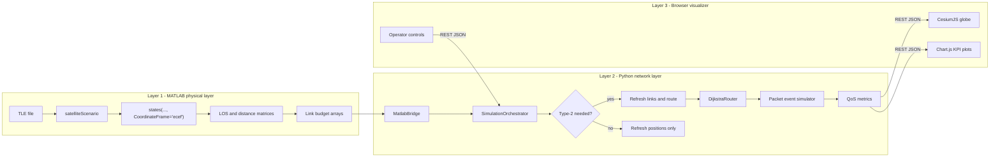
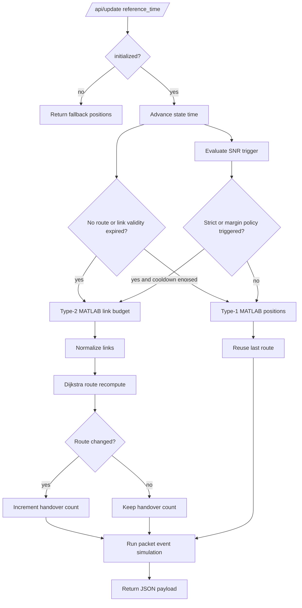

# 6G LEO Satellite NTN Simulator - Technical Documentation

## Table of Contents

- [1. Executive Summary](#1-executive-summary)
- [2. Motivation](#2-motivation)
- [3. System Architecture](#3-system-architecture)
- [4. Physical Layer - MATLAB](#4-physical-layer---matlab)
- [5. Network Layer - Python](#5-network-layer---python)
- [6. Visualization and Analytics Layer](#6-visualization-and-analytics-layer)
- [7. Repository Structure](#7-repository-structure)
- [8. Team](#8-team)
- [9. Appendix - API Parameter Reference](#9-appendix---api-parameter-reference)

## 1. Executive Summary

The 6G LEO Satellite NTN Simulator is an end-to-end simulation framework for 6G Non-Terrestrial Networks. It models direct-to-device communication over a moving satellite constellation, converts orbital geometry into a routable graph, runs routing and handover decisions over that graph, and exposes the result to an interactive CesiumJS operator dashboard.

The system has three layers:

- MATLAB owns the physical/orbital layer: TLE ingestion, satellite propagation, Earth-occlusion checks, ground-to-satellite distance checks, and link budget estimation.
- Python owns the network layer: MATLAB Engine integration, Type-1/Type-2 polling policy, graph routing, SNR-triggered handover, packet-level queue simulation, and REST API exposure.
- The browser frontend owns the visualization layer: CesiumJS 3D globe, UE/route/link rendering, operator controls, and Chart.js KPI plots.

The implementation is a live polling interface built around `/api/init` and `/api/update`, with Dijkstra routing over selectable metrics: `min_hop`, `total_delay_ms`, and `distance_km`.

## 2. Motivation

Direct-to-device satellite connectivity is one of the headline use cases for 6G NTN. Unlike terrestrial networks, a LEO NTN topology is not static: satellites move, line-of-sight windows open and close, propagation delay changes continuously, and links can degrade as SNR margin erodes.

This project makes that behavior visible and measurable:

- Turn orbital mechanics into a time-varying graph.
- Route UE-to-UE traffic through satellites and ground-facing access links.
- Recompute routes when the topology validity window expires or link quality suggests a handover.
- Convert path choices into network-level metrics: throughput, latency, packet loss, packet counters, queueing delay, and route handover count.
- Show the topology and active route in a live 3D browser console.

## 3. System Architecture



| Branch/area | Module | Responsibility |
|---|---|---|
| Physical layer | `matlab/` | TLE propagation, ECEF positions, LOS/distance checks, RF/link metrics |
| Network layer | `python/` | MATLAB bridge, orchestration state, routing, handover logic, packet simulation, REST API |
| Visualization layer | `visualizer/` | CesiumJS globe, UE controls, route rendering, KPI charts |
| Documentation/contracts | `docs/` | MATLAB/Python bridge contract and this project documentation |

### Why three layers instead of one monolith?

MATLAB is used where it adds real value: `satelliteScenario`, `satellite(sc, tleFile)`, `states`, `groundStation`, transmitter/receiver objects, antenna primitives, and time-aware propagation from TLEs. Python is used where the project needs normal software infrastructure: REST endpoints, graph algorithms, session state, queue/event simulation, and robust fallback behavior. The browser is used because CesiumJS gives an interactive WGS84 3D globe without asking the operator to install MATLAB or Python UI tooling.

The separation is also operationally useful. The Python server continues with a deterministic fallback constellation if MATLAB Engine is unavailable, and the frontend only depends on JSON payloads, keeping demo failure modes contained.

## 4. Physical Layer - MATLAB

### 4.1 Propagation model

The physical layer initializes a MATLAB `satelliteScenario`:

- `startTime`: supplied from Python as a POSIX timestamp and converted to UTC `datetime`.
- `stopTime`: `startTime + hours(6)`.
- `sampleTime`: `30` seconds.
- satellites: loaded with `satellite(sc, tleFile)` from a resolved and filtered TLE file.

The satellites are created from TLEs through MATLAB Satellite Communications Toolbox, using the toolbox's SGP4-style TLE propagator.

MATLAB was chosen over a Python orbital library such as Skyfield or poliastro because it already supplies the scenario object model, TLE-backed satellite objects, ground stations, antenna/transmitter/receiver primitives, and coordinate-frame aware `states(...)` calls in one environment, reducing the amount of custom astrodynamics code that needs to be validated.

### 4.2 TLE inputs and constellation handling

The frontend calls `/api/tle_list`, displays available `.tle` files, and submits `tle_file` to `/api/init`.

Supported TLE files:

| TLE file | Objects | Inclination range/mean | Derived altitude range/mean | Notes |
|---|---:|---|---|---|
| `IridiumNEXT.tle` | 75 | 86.40-86.61 deg, mean 86.41 deg | 653.9-777.7 km, mean 770.9 km | Main Iridium-like operating set used by default UI options. |
| `OneWeb.tle` | 651 | 86.68-88.93 deg, mean 87.90 deg | 526.6-1225.3 km, mean 1197.6 km | OneWeb-like polar shell data from TLEs. |
| `starlink.tle` | 7153 | 42.98-97.67 deg, mean 51.84 deg | 160.6-574.6 km, mean 504.9 km | Large Starlink catalog including varied shells. |
| `SatellitesOrbitalParameters.tle` | 94 | 0.04-101.99 deg, mean 89.16 deg | 185.9-35785.8 km, mean 930.7 km | Mixed amateur/general satellite reference file. |

The MATLAB initializer filters TLEs before loading by reading each 3-line TLE block and keeping only entries whose mean motion is below `15.7` rev/day. It writes the result as `clean_<originalName>.tle` beside the original file, removing very low orbit entries that would be unstable for the live simulation.

### 4.3 Coordinate frames

MATLAB returns satellite positions in ECEF:

```matlab
states(state.satellites, queryTime, "CoordinateFrame", "ecef")
```

The positions are converted from meters to kilometers before crossing into Python. ECEF is the practical frame for this simulator because:

- ground station coordinates are naturally Earth-fixed;
- Cesium can render Earth-centered Cartesian coordinates directly after multiplying kilometers back to meters;
- distance and occlusion calculations stay consistent when satellites and ground nodes share one Earth-fixed frame.

The Python fallback path also creates an approximate orbital model, rotates ECI-like coordinates into ECEF using Earth rotation rate `7.2921159e-5 rad/s`, and exports `x_km`, `y_km`, `z_km`.

### 4.4 LOS and visibility computation

Satellite-to-satellite visibility is computed in `satDistances.m`.

The function takes an `N x 3` ECEF position matrix in meters and applies an Earth-occlusion angular test:

- effective obstacle radius: `(6371 + 50) km`, converted to meters;
- per-satellite horizon angle: `alpha = acos(R_eff / r)`;
- separation angle between two satellites: `theta = acos(dot(r_i, r_j) / (|r_i||r_j|))`;
- visible if `theta < alpha_i + alpha_j`;
- non-visible pairs and self-links are set to `NaN`;
- visible distances are Euclidean chord distances.

The additional 50 km acts as an atmospheric/clearance margin, providing a conservative visibility boundary.

Ground-to-satellite visibility is handled in `gsSatDistances.m` and `ntn_link_budget.m`:

- ground latitude/longitude/altitude are converted to WGS84 ECEF;
- Euclidean ground-satellite distances are computed by matrix multiplication;
- links beyond `2000 km` are discarded;
- the exported link budget uses a fixed `el = 10` degree elevation reference for ground links.

Satellite-satellite LOS is therefore an Earth-occlusion test, while ground-satellite access links use a distance-gated approximation tuned for live-loop performance.

### 4.5 Link budget model

The link budget is intentionally lightweight but explicit.

Core constants and defaults:

- carrier frequency: `28 GHz`;
- satellite transmitter power in setup helpers: `20 W`;
- bit rate in setup helpers: `100 Mbps`;
- satellite system loss: `3 dB`;
- satellite dish diameter: `0.5 m`;
- ground minimum elevation default: `10 deg`;
- ground patch antenna designed at `28 GHz`;
- satellite velocity approximation for Doppler/TEC: `7.5 km/s`;
- rain rate default: `1 mm/h`.

`channelModel.m` approximates ITU-R P.618/P.676/P.838-like losses:

- oxygen attenuation;
- water vapor attenuation;
- slant path scaled by elevation;
- rain attenuation using interpolated P.838-style `k` and `alpha`;
- scintillation loss `0.2 + 0.01 * freqGHz`;
- total loss as the sum of atmospheric, rain, and scintillation terms;
- SNR margin as `8.0 - total_loss_db`;
- Free-space loss.

`channelDelay.m` adds:

- Doppler estimate from radial velocity `v * cos(elevation)`;
- Doppler rate estimate using a nominal 550 km orbital radius;
- TEC delay using a coarse time-of-day TEC table.

`ntn_link_capacity.m` computes bit/s capacity from SNR:

```text
eta = min(log2(1 + snr_linear), modulation_efficiency_ceiling)
R = bandwidth * eta * (1 - overhead) * processing_loss
```

Default capacity profiles:

| Link type | Bandwidth | Modulation efficiency cap | Overhead | Processing factor |
|---|---:|---:|---:|---:|
| `D2D` | 10 MHz | 4 bits/s/Hz | 0.20 | 0.85 |
| `ISL_RF` | 150 MHz | 8 bits/s/Hz | 0.10 | 0.93 |
| `ISL_OPT` | 2 GHz | 20 bits/s/Hz | 0.05 | 0.95 |

Packet loss probability is exported as:

```text
packet_loss_prob = exp(-max(snr_margin_db, 0) / 5)
```

This model keeps link behavior monotonic and explainable.

### 4.6 Link construction and data handed to Python

`ntn_link_budget(reference_time)` exports flat arrays rather than nested MATLAB structs. Python's `MatlabBridge` converts those arrays into JSON-friendly dictionaries.

Satellite arrays:

- `timestamp`: POSIX seconds;
- `satellites_id`: cell array of string IDs;
- `satellites_x`: ECEF x in km;
- `satellites_y`: ECEF y in km;
- `satellites_z`: ECEF z in km.

Link arrays:

- `links_source`;
- `links_target`;
- `links_delay_ms`;
- `links_distance_km`;
- `links_capacity_mbps`;
- `links_snr_db`;
- `links_margin_db`;
- `links_elevation_deg`;
- `links_path_loss_db`;
- `links_packet_loss_prob`;
- `link_valid_for_seconds`.

Satellite-satellite links are generated by evaluating all visible pairs, computing candidate RF metrics, then keeping up to four highest-SNR candidates per satellite. Links are made undirected by keeping only pairs where `source < target`.

Ground-satellite links connect each ground station to every satellite passing the distance gate. The link source is the ground station name and the target is the satellite ID.

## 5. Network Layer - Python

### 5.1 Orchestration model

The Python server is a Flask app in `python/api_server.py`. It creates one process-wide `SimulationOrchestrator`, which owns mutable session state and a `MatlabBridge`.

The live loop has two MATLAB call types:

- Type 1: `ntn_update_positions(reference_time)` returns positions only.
- Type 2: `ntn_link_budget(reference_time)` returns positions, links, RF metrics, and `link_valid_for_seconds`.

The trigger policy is:

1. `/api/init` resolves the TLE, extracts the first TLE epoch as the default simulation start, initializes MATLAB, then performs an initial Type-2 call.
2. `/api/update?reference_time=...` advances the simulation to a caller-supplied timestamp.
3. Python calls Type 2 when there is no route, when `reference_time >= link_valid_until`, or when the SNR handover policy forces a recompute.
4. Otherwise Python calls Type 1 and reuses the last valid route and link set.

The frontend polls at a configurable step, but expensive link recomputation is event-triggered by validity expiry or SNR/handover conditions rather than recomputed on every tick.

### 5.2 Dynamic graph construction and weights

The graph source is MATLAB's `links` array from Type 2. Python normalizes each link to:

- `source`, `target`;
- `delay_ms`;
- `distance_km`;
- `capacity_mbps`;
- optional RF diagnostics: `snr_db`, `margin_db`, `elevation_deg`, `path_loss_db`, `packet_loss_prob`.

`DijkstraRouter.build_graph()` builds an undirected NetworkX graph. Edge weight is selected by `CostMetric`:

- `min_hop`: every edge weight is `1.0`;
- `distance_km`: edge weight is `distance_km`;
- `total_delay_ms`: edge weight is `delay_ms`.

If MATLAB does not return usable links, `TopologyBuilder.build_links_from_positions()` creates a fallback graph by connecting each satellite to its two nearest neighbors. In the fallback:

- `delay_ms = distance_km / 299.792458`;
- `capacity_mbps = max(25, 1200 - 0.08 * distance_km)`;
- validity is estimated from average link distance and clamped to 5-60 seconds.

Ground links can also be synthesized in Python by connecting each ground node to the two nearest satellites with the same delay/capacity formulas. Primary ground links come from MATLAB when available.

### 5.3 Implemented routing strategies

The API exposes three routing metrics:

| UI/API value | Code path | Cost function | Real-world problem represented |
|---|---|---|---|
| `min_hop` | `DijkstraRouter` with `CostMetric.MIN_HOP` | Each link has cost `1`; minimize hop count. | Reduces forwarding complexity and packet processing exposure. Good baseline when link metrics are uncertain. |
| `total_delay_ms` | `DijkstraRouter` with `CostMetric.TOTAL_DELAY_MS` | Minimize sum of propagation/link delays. | Latency-sensitive services where a longer hop count may be acceptable if geometry is better. |
| `distance_km` | `DijkstraRouter` with `CostMetric.DISTANCE_KM` | Minimize sum of path distance. | Geometry-aware routing; often tracks delay but stays independent of TEC/RF delay terms. |

### 5.4 Routing decision logic



### 5.5 Self-healing and handover

Self-healing is implemented as reactive recomputation:

- A route is recomputed on Type-2 refresh.
- Type-2 refresh occurs on link-validity expiry, missing route, or SNR trigger.
- If the recomputed path differs from the previous path, `handover_count` is incremented and `handover.route_changed` is returned.
- The packet simulator then rebuilds path-local entities for the new route and clears future in-flight events during handover recovery.

There are two SNR handover modes:

- `strict`: trigger when any latest SNR sample falls below `_snr_strict_threshold_db` (default `0.0 dB`), or when no route exists.
- `margin`: trigger on sustained low worst-link margin, rapid short-window versus long-window SNR drop, or an alternative route whose worst SNR exceeds the current worst SNR by hysteresis.

Margin-mode constants:

- short window: 5 s;
- long window: 20 s;
- required margin: 3 dB;
- safety margin: 2 dB;
- drop-rate trigger: 1 dB;
- sustained trigger time: 4 s;
- hysteresis: 3 dB;
- forced Type-2 cooldown: 3 s.

### 5.6 Packet/event simulation

After routing, `NetworkOrchestrator` extracts ordered path links and builds path-local entities:

- one `SourceState`;
- one `ReceiverState`;
- one `NetworkNode` per route hop except the final receiver;
- one class queue per configured priority level on each node.

The event loop uses a heap-based future event set. Events include:

- `user_generate`;
- `node_arrival`;
- `receiver_arrival`;
- `tx_complete`.

User traffic can be:

- CBR: deterministic packet generation at `avg_rate_mbps`;
- VBR: ON/OFF source, with ON-state generation at `peak_rate_mbps`; average load is controlled by `avg_rate_mbps / peak_rate_mbps`; burstiness increases the mean ON duration.

Queueing policy:

- shared tail-drop buffer in packets;
- strict-priority classes always win if non-empty;
- otherwise weighted round robin among WRR classes;
- lower numeric priority means higher precedence.

Transmission time is:

```text
tx_time_seconds = packet_size_bits / link_capacity_bits_per_second
```

Propagation delay per hop is the link's `delay_ms`.

### 5.7 QoS metrics

Implemented metrics:

- throughput per monitor window: `8 * bytes_arrived / window_duration / 1e6`;
- throughput aggregate: min/avg/max over monitor windows;
- latency per arrived packet: `(arrival_time - packet.created_at) * 1000`;
- latency aggregate: min/avg/max over windows with samples;
- packet loss ratio per window: `packets_dropped / packets_created`;
- packet loss aggregate: total step drops divided by total step packet creations;
- packet counters: `packets_created`, `packets_arrived`;
- handover count: incremented when a successful recomputed route path differs from the previous path;
- per-route-node queueing delay min/avg/max;
- per-route-node packet drop ratio;
- per-route-node active connected links count.

### 5.8 Why these routing choices?

The implemented Dijkstra metrics let the same dynamic topology be evaluated under three transparent objectives: fewest hops, shortest distance, and lowest modeled delay. This keeps the routing layer easy to reason about and interpret while the MATLAB link-budget computation remains the main computational cost in the pipeline.

## 6. Visualization and Analytics Layer

### 6.1 Operator visualizer (`visualizer/index.html`)

The visualizer is a single HTML/JS app with no build step. It uses:

- CesiumJS 1.117 for the 3D globe;
- Cesium Ion imagery when available, plus a generated local Earth texture fallback;
- Chart.js for throughput, latency, and packet loss plots;
- plain Fetch API calls to the Flask backend.

The UI is organized into tabs:

- Connection: API URL, TLE file, simulation time, step size, backend/MATLAB start, init/update/auto-poll controls.
- Flow Setup: source/destination UEs, routing metric, handover mode, UE creation, CBR/VBR flow parameters.
- Network Setup: packet size, buffer size, priority class definitions.
- Simulation Results: KPI cards, line charts, and route/path details.
- Status and Debug: route, payload, event log, and snapshot metadata.

The frontend renders:

- satellites as Cesium billboards at ECEF coordinates;
- UEs at lat/lon positions;
- topology links as polylines;
- active route as a highlighted polyline;
- route hop cards with delay/capacity and per-node queue stats.

### 6.2 Analytics dashboard

Analytics are implemented with Chart.js in `visualizer/index.html`, fed directly from `/api/init` and `/api/update` responses.

### 6.3 Why CesiumJS?

CesiumJS was selected because it natively supports a WGS84/Earth-centered 3D scene, imagery layers, camera control, billboards, and polylines, and runs from a static HTML file without requiring a custom rendering pipeline.

### 6.4 Why REST instead of embedding Python directly?

The REST boundary keeps the browser, Python, and MATLAB failure domains separate. The frontend can be opened as a static file, the backend can be restarted independently, and MATLAB Engine issues do not prevent Python from returning fallback data. This design simplifies demos and dependency management across platforms.

## 7. Repository Structure

```text
.
|-- docs/
|   |-- images/
|   |-- Customer & User Guide.pdf
|   |-- DOCUMENTATION.md
|   `-- PowerPoint Presentation.pdf
|-- matlab/
|   |-- IridiumNEXT.tle
|   |-- OneWeb.tle
|   |-- SatellitesOrbitalParameters.tle
|   |-- starlink.tle
|   `-- Functions/
|       |-- addGroundStations.m
|       |-- addSatellites.m
|       |-- channelDelay.m
|       |-- channelModel.m
|       |-- gsSatDistances.m
|       |-- ntn_bridge_state.m
|       |-- ntn_initialize_simulation.m
|       |-- ntn_link_budget.m
|       |-- ntn_link_capacity.m
|       |-- ntn_positions_matrix.m
|       |-- ntn_satellite_positions.m
|       |-- ntn_update_positions.m
|       `-- satDistances.m
|-- python/
|   |-- api_server.py
|   |-- README.md
|   |-- algorithms/
|   |   |-- dijkstra_router.py
|   |   |-- min_hop_count.py
|   |   `-- disco_route.py
|   |-- services/
|   |   |-- __init__.py
|   |   |-- orchestrator.py
|   |   `-- topology.py
|   |-- packetSimulator/
|   |   |-- monitoring.py
|   |   |-- network_models.py
|   |   |-- network_orchestrator.py
|   |   |-- queueing.py
|   |   `-- traffic_generation.py
|   `-- utils/
|       `-- matlab_bridge.py
|-- visualizer/
|   |-- index.html
|   `-- landing_site.html
|-- .gitignore
|-- InstallationGuide.md
|-- LICENSE
|-- README.md
`-- requirements.txt
```

## 8. Team

- Giulio Bollea - Network Layer Simulation & Integration Testing.
- Paolo Cerutto - Physical Layer Simulation & Integration Testing.
- Gianluca Ditella - Frontend Integration, Visualization Flow & Repo Coordination.
- Jacopo Piergiovanni - Architecture & Routing Logic Implementation.

## 9. Appendix - API Parameter Reference

### `/api/health` - GET

Liveness check.

Response:

```json
{
  "status": "ok",
  "timestamp": 0
}
```

### `/api/ready` - GET

Reports whether the orchestrator has been initialized.

Response:

```json
{
  "ready": true
}
```

### `/api/tle_list` - GET

Lists `.tle` files under the project root as paths relative to the root where possible.

Response:

```json
{
  "tle_files": ["matlab/IridiumNEXT.tle"]
}
```

### `/api/start_matlab` - POST

Attempts to connect to an existing MATLAB Engine session or start one.

Request body: none required.

Response fields:

- `ok`;
- `message`;
- optional `note` or `error`.

### `/api/matlab_state` - GET

Returns current MATLAB persistent-state metadata when MATLAB Engine is connected.

Response fields:

- `ok`;
- `number_satellites`;
- `tle_file`;
- `sample_time_seconds`;
- or `error`.

### `/api/init` - POST

Initializes one live simulation session.

```json
{
  "tle_file": "string",
  "simulation_start_time": "number (POSIX seconds)",
  "source": "string",
  "destination": "string",
  "metric": "min_hop|total_delay_ms|distance_km",
  "handover_mode": "strict|margin",
  "ground_nodes": "[{node_id, lat_deg, lon_deg}]",
  "buffer_size": "number (packets)",
  "packet_size_bytes": "number",
  "monitor_interval": "number (seconds)",
  "priority_levels": "[{priority, scheduling, weight, label, fraction_of_load}]",
  "user_flow_priority": "number",
  "user_flow_cbr_vbr": "CBR|VBR",
  "user_flow_peak_rate": "number (Mbps)",
  "user_flow_avg_rate": "number (Mbps)",
  "user_flow_burstiness": "number"
}
```

Default values used in `api_server.py`:

- `source`: `"0"`;
- `destination`: `"1"`;
- `metric`: `min_hop`;
- `handover_mode`: `margin`;
- `buffer_size`: `256`;
- `packet_size_bytes`: `1500`;
- `monitor_interval`: `1`;
- `user_flow_priority`: `1`;
- `user_flow_cbr_vbr`: `CBR`;
- `user_flow_peak_rate`: `5`;
- `user_flow_avg_rate`: `5`;
- `user_flow_burstiness`: `0.5`.

Response includes:

- `ok`;
- `matlab`;
- `next_type2_after`;
- `state`;
- `reference_time`;
- `positions`;
- `route`;
- `user_measured_throughput`;
- `user_measured_latency`;
- `user_measured_loss_ratio`;
- `packets_created`;
- `packets_arrived`;
- `route_node_stats`.

### `/api/update` - GET

Advances or polls the live session.

Query parameters:

- `reference_time`: optional POSIX timestamp. If omitted, Python uses current wall-clock time.

Response includes:

- `ok`;
- `call_type`: `type1`, `type2`, or `fallback`;
- `reference_time`;
- `next_type2_after`;
- `matlab`;
- `handover`: `{count, gateway, route_changed}`;
- `handover_mode`;
- `snr_trigger`: `{triggered, reason}`;
- `positions`;
- `route`;
- `user_measured_throughput`;
- `user_measured_latency`;
- `user_measured_loss_ratio`;
- `packets_created`;
- `packets_arrived`;
- `route_node_stats`.
